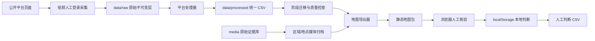
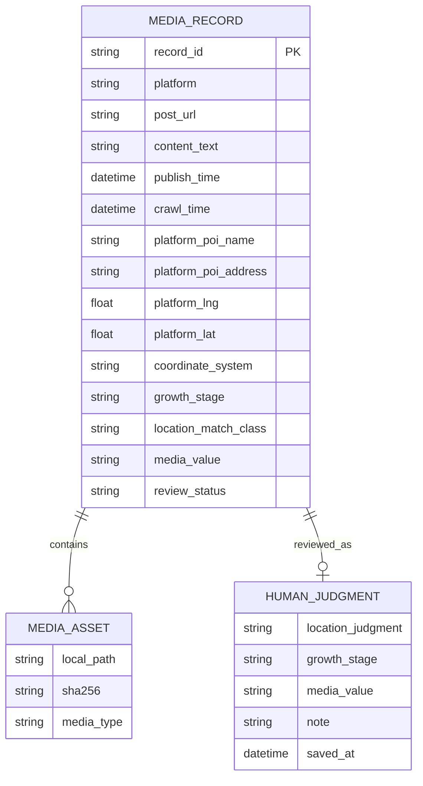

# 武汉东湖水生植被媒体核验系统——设计方案

版本：0.5.0  
状态：已实现静态研究原型，可继续扩展为多用户服务。

## 1. 设计目标

系统服务于“从公开媒体证据观察武汉东湖水生植被物候，并核对发布地点与实际拍摄地点”的研究流程。核心目标是：

- 多平台异构数据统一；
- 原始证据与人工推断分离；
- 对时间和位置不确定性显式建模；
- 在遥感影像地图上快速核验媒体；
- 保证标注可追溯、可撤销、可导出；
- 公开代码时不泄露凭据、身份信息或受版权保护的媒体。

## 2. 设计原则

1. **原始层不可变**：采集文件只进入 `data/raw/`，处理器不回写原始文件。
2. **事实与推断分离**：平台字段标记为 observed；视觉地点、物候和一致性属于 inferred。
3. **未知优于猜测**：缺少发布时间、坐标系或画面证据时使用 `unknown`/空值。
4. **可逆标注**：无意义点位只过滤、不物理删除。
5. **最小化收集**：不保留作者昵称、账号 ID 等研究非必要身份字段。
6. **发布边界明确**：代码可发布，原始数据、媒体、登录态和私有部署信息不可发布。

## 3. 总体架构

当前实现是本地优先的静态架构：没有后端数据库、没有用户认证服务、没有服务器端写入。这样降低部署与隐私风险，适合单研究者核验。

## 4. 模块划分

| 层 | 模块 | 职责 |
|---|---|---|
| 采集层 | `scripts/`、外部采集器 | 启动浏览器、关键词检索、保存平台原始响应 |
| 原始层 | `data/raw/` | 保留原始 JSON/CSV，禁止就地修改 |
| 媒体层 | `media/` | 保存图片、视频、封面和关键帧 |
| 地点归档层 | `media_collected/` | 按区域/地点/平台组织实际媒体，以 SHA-256 去重，不保存正文和身份字段 |
| 隔离层 | `media_quarantine/` | 保存地域误匹配或质量异常媒体，可恢复，不参与正式统计和地图展示 |
| 处理层 | `src/build_*`、`src/process_*` | 字段清洗、下载、去重、时间解析、相关性筛选 |
| 统一层 | `data/processed/*_posts.csv` | 统一字段和平台合并表 |
| 标注层 | `src/apply_visual_screen.py`、`src/migrate_annotation_schema.py` | 写入预标注、迁移标签、保留来源说明 |
| 展示层 | `src/export_map_site.py` | 坐标转换、媒体压缩、生成地图 JSON |
| 前端层 | `sites/east-lake-map/dist/` | 地图筛选、图集浏览、本地判断和 CSV 导出 |
| 安全层 | `.gitignore`、`src/check_public_release.py` | 阻止凭据、个人路径、媒体与研究数据进入发布仓库 |

## 5. 数据分层与数据流

### 5.1 原始层

保存平台页面直接观察到的信息和采集时间。原始层可包含受版权保护的文案、媒体 URL 和页面结构，因此只限内部研究。

### 5.2 处理层

各平台处理器完成：

- 稳定 `record_id` 生成；
- 时间解析和时区统一；
- 区域与植被相关性筛选；
- 媒体下载和 SHA-256；
- POI、地址和坐标映射；
- 统一 CSV 输出。

### 5.3 展示层

地图导出器读取平台 CSV 和本地媒体，生成：

- `points.json`：前端点位和研究字段；
- `summary.json`：数量与平台摘要；
- WebP 媒体：面向核验的压缩副本。

这些是生成物，包含第三方内容，不能作为公开源码发布。

## 6. 统一记录模型

核心实体为 `MediaRecord`：

当前 CSV 将主媒体信息内联在记录中；同一相册的其他媒体通过同目录文件发现。未来数据库化时应拆成 `media_record` 与 `media_asset` 两表。

## 7. 标注状态设计

### 7.1 植被阶段

使用五值枚举：四个研究阶段加 `unknown`。迁移遵循：

- `emergence` → `growth_start`；
- `leaf`、`flower_bud`、`flowering`、`fruiting` → `fully_grown`；
- `senescent` → `decline_start`；
- `dormant` → `declined`。

旧标签保存在备注中，避免迁移后丢失细粒度信息。

### 7.2 媒体价值

- `meaningful`：媒体可支持位置或植被研究；
- `meaningless`：无目标、模糊、重复或无法提供有效证据；
- `unknown`：尚未判断。

前端过滤条件为：`media_value != meaningless`，除非用户主动开启恢复显示。

## 8. 空间设计

### 8.1 坐标来源等级

1. `platform_observed_unknown_crs`：平台返回坐标，但坐标系仍需核实；
2. `poi_estimated`：根据地点名称匹配预设 POI；
3. `regional_centroid`：只有区域证据时使用东湖区域中心。

前端用不同视觉样式区分原始坐标和估计坐标。

### 8.2 坐标转换

地图渲染使用 WGS84 形式的经纬度；系统把按 GCJ-02 假设的坐标转换到 WGS84 后交给百度 CRS 插件。由于来源坐标系可能未知，记录保留转换假设，不能把结果视为测量级定位。

### 8.3 位置一致性

位置核验综合：岸线形态、桥梁、栈道、建筑、远景天际线、植被斑块和 POI 名称。系统不自动判定一致性，只展示证据并记录人工结论。

## 9. 时间设计

- 所有可解析时间统一为 Asia/Shanghai。
- 只有日期的平台记录保留 `time_precision=date`。
- 百度地点相册无可见时间时保持空值。
- 前端使用 `timeKnown=false` 区分未知时间，并由独立开关控制。
- 带“库存、回忆、去年、转载”等语义的记录需人工降低时间可信度。

## 10. 前端设计

### 10.1 技术选型

- 原生 HTML/CSS/JavaScript；
- Leaflet 地图；
- Leaflet.markercluster 点聚合；
- 百度遥感瓦片和道路标注；
- `localStorage` 保存单用户判断。

不引入前端构建工具，使站点可以通过任意静态服务器运行。

### 10.2 状态模型

前端状态包含：

- 原始点位数组；
- 平台、年份、阶段、一致性等筛选器；
- 当前点位和图集索引；
- `localStorage` 中的人工判断覆盖层。

人工判断与源数据合并时，人工值优先用于筛选和展示，但不会改写 `points.json`。

### 10.3 导出

浏览器把人工判断序列化为 CSV。导出字段包括记录 ID、平台、位置判断、植被阶段、媒体价值、备注和保存时间。CSV 可进一步合并回研究数据，但应经过人工审核。

## 11. 安全与隐私设计

### 11.1 威胁边界

主要风险包括：

- Git 提交 API Key、Token 或 Cookie；
- 上传浏览器 profile 导致账号会话泄露；
- 公开原始文案、作者信息、图片或视频；
- 公开本机绝对路径、邮箱或私有部署 ID；
- 把 POI 误表述为真实拍摄位置。

### 11.2 控制措施

- `.env.example` 只保存占位符，真实 `.env` 被忽略；
- 数据、媒体、profile、vendor 和部署元数据全部被 `.gitignore` 排除；
- 公开检查器扫描受限路径和常见凭据格式，只报告位置，不回显密钥；
- CI 对每次 push 和 PR 执行同一检查；
- 处理数据不保留作者 ID 和昵称；
- 文档明确媒体版权和位置/时间不确定性。

### 11.3 密钥管理

本地开发优先使用系统钥匙串、GitHub CLI 登录或 CI Secrets。不得在命令历史、脚本参数、日志、截图和文档中粘贴真实 Token。

## 12. 部署方案

### 12.1 本地部署

使用 `python3 -m http.server` 服务静态目录。适合单人研究和离线核验。

### 12.2 私有静态站点

将生成后的 `dist/` 发布到访问受控的静态托管服务。由于包内包含第三方媒体和原始文案，必须使用私有访问策略，不应部署为公共站点。

### 12.3 公开 GitHub 仓库

只发布源码、静态前端模板、配置占位符和文档。排除 `points.json`、`summary.json` 和媒体目录。用户从自己的合法本地数据重新生成这些内容。

## 13. 扩展设计

### 13.1 多用户后端

如需多人协作，可增加 FastAPI + PostgreSQL/PostGIS：

- `records`：平台记录；
- `media_assets`：媒体元数据；
- `judgments`：按用户和版本保存判断；
- `audit_logs`：记录创建、修改和导出；
- 对记录和判断启用 RBAC/RLS。

接口建议使用 `/v1/records`、`/v1/records/{id}/judgments` 和游标分页。原始媒体使用受控对象存储和短时签名 URL。

### 13.2 自动视觉辅助

可增加水生植被检测、场景检索或 CLIP 相似度作为候选排序，但模型输出只能作为辅助，不得覆盖人工标注。模型版本、阈值和置信度必须记录。

### 13.3 物候分析

完成精标后，可按地点、旬/月和平台分层，估计各阶段比例。分析需校正平台覆盖、近期排序、重复事件和时间不确定性，避免把社交媒体样本当作均匀监测样本。

## 14. 质量保证

- Python：`python3 -m compileall -q src`；
- JavaScript：`node --check sites/east-lake-map/dist/app.js`；
- 发布边界：`python3 src/check_public_release.py --root .`；
- 数据数量、平台分布和媒体引用完整性由导出后检查脚本复核；
- 关键交互使用 Playwright 验证筛选、图集、保存、隐藏和恢复。

## 15. 已知限制

- 平台页面和接口会变化，采集器需要维护。
- 地图瓦片许可和可用性由第三方控制。
- 当前判断只保存在单浏览器，尚无多人冲突处理。
- 百度相册没有时间字段。
- 大量点位使用 POI 估计或区域中心，不适合精确空间统计。
- 当前样本存在平台排序、地区热度和季节性发布偏倚。

## 16. 验收标准

一个发布版本应同时满足：

1. 处理脚本可编译；
2. 前端 JavaScript 语法检查通过；
3. 发布检查器无发现；
4. 仓库中没有原始数据、媒体、登录态或部署密钥；
5. 四阶段和媒体价值枚举与文档一致；
6. 无意义点位可隐藏、恢复和撤销；
7. 未知时间记录不会被伪造日期；
8. 用户手册、数据卡和伦理审查与代码版本一致。

